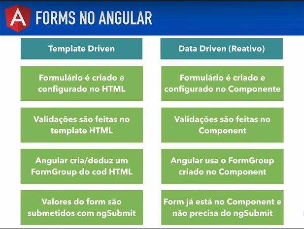

# Angular V2

## Aula 72 - Formulários (template vs data / reativo) Introdução

No ecossistema do Angular Versão 2, existem duas abordagens principais para criar e gerenciar formulários: Template-Driven Forms (Formulários Orientados a Template) e Data-Driven Forms (também conhecidos como Formulários Reativos ou Model-Driven Forms).

Ambas compartilham o mesmo objetivo (coletar dados do usuário, validar entradas e gerenciar o estado), mas filosofias de design totalmente opostas.



### 1. Template-Driven Forms (Baseados no Template)

Nos formulários orientados a template, a maior parte da lógica de controle, validação e estado fica diretamente no arquivo **HTML (template)**, utilizando diretivas do Angular como `ngModel` e `ngForm`.

- **Como funciona**: O Angular cria automaticamente o modelo de controle por trás dos panos com base nas tags HTML e nas diretivas que você declara.
- **Paradigma**: Imperativo / Orientado ao DOM.
- **Ideal para**: Formulários simples, telas de login, cadastros rápidos ou quando você não precisa manipular a árvore de controles via código TypeScript de forma complexa.

### Exemplo Rápido (Template-Driven):

```TypeScript
// login.component.ts
import { Component } from '@angular/core';

@Component({
  selector: 'app-login',
  template: `
    <form #f="ngForm" (ngSubmit)="onSubmit(f)">
      <div>
        <label>Email:</label>
        <input type="email" name="email" ngModel required />
      </div>
      <div>
        <label>Senha:</label>
        <input type="password" name="senha" ngModel required minlength="6" />
      </div>
      <button type="submit" [disabled]="!f.valid">Entrar</button>
    </form>
  `
})
export class LoginComponent {
  onSubmit(form: any) {
    console.log('Dados do formulário:', form.value);
    console.log('O formulário é válido?', form.valid);
  }
}
```

### 2. Data-Driven / Reactive Forms (Baseados em Dados / Reativos)

Nos formulários reativos, o modelo do formulário (a árvore de `FormControl`, `FormGroup` e `FormArray`) é **explicitamente definido no código TypeScript**. O HTML apenas faz a ligação (binding) com essas instâncias.

- **Como funciona**: Você constrói a estrutura lógica do formulário no componente antes de exibi-lo. Como é baseado em Streams e Observables (via `ReactiveFormsModule`), você consegue escutar alterações de valor em tempo real (`valueChanges`) ou status de validação (`statusChanges`).
- **Paradigma**: Reativo / Orientado a Modelo.
- **Ideal para**: Formulários complexos, formulários dinâmicos (onde campos aparecem/somem com base em regras), validações assíncronas customizadas e aplicações de grande escala.

### Exemplo Rápido (Reactive Forms):

```TypeScript
// cadastro.component.ts
import { Component, OnInit } from '@angular/core';
import { FormGroup, FormControl, Validators } from '@angular/forms';

@Component({
  selector: 'app-cadastro',
  template: `
    <form [formGroup]="formCadastro" (ngSubmit)="onSubmit()">
      <div>
        <label>Nome:</label>
        <input type="text" formControlName="nome" />
      </div>
      <div>
        <label>Email:</label>
        <input type="email" formControlName="email" />
      </div>
      <button type="submit" [disabled]="!formCadastro.valid">Salvar</button>
    </form>
  `
})
export class CadastroComponent implements OnInit {
  formCadastro: FormGroup;

  ngOnInit() {
    // Definindo a estrutura e validações explicitamente no TypeScript
    this.formCadastro = new FormGroup({
      'nome': new FormControl('', Validators.required),
      'email': new FormControl('', [Validators.required, Validators.email])
    });
  }

  onSubmit() {
    console.log(this.formCadastro.value);
    console.log(this.formCadastro.valid);
  }
}
```