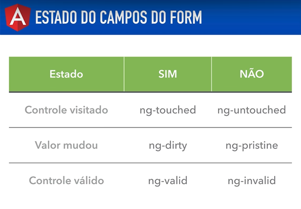

# Angular V2

## Aula 78 - Forms (template driven) Aplicando CSS na Validação dos Campos

No ecossistema do Angular Versão 2, uma das funcionalidades mais poderosas dos formulários (tanto Template-Driven quanto Reactive) é a injeção automática de classes CSS de estado diretamente nos elementos HTML (`input`, `select`, `textarea`, `form`).

O Angular monitora a interação do usuário e adiciona ou remove classes dinamicamente em tempo real, permitindo que você altere a aparência visual dos campos (como adicionar bordas vermelhas para erros ou verdes para sucessos) puramente via CSS.

### As Classes CSS Automáticas do Angular

Conforme o usuário interage com o campo, o Angular aplica combinações destas classes:

| Estado do Campo | Classes Aplicadas (Quando verdadeiro) | Classes Opostas (Quando falso) |
| :--- | :--- | :--- |
| Interação | `ng-touched` (usuário saiu do campo) | `ng-untouched` (campo não foi focado ainda) |
| Modificação | `ng-dirty` (valor foi alterado) | `ng-pristine` (valor está intacto/original) |
| Validação | `ng-valid` (passou nas regras) | `ng-invalid` (falhou em alguma regra) |



### Exemplo Prático: Aplicando Estilos CSS

Para estilizar campos inválidos apenas após o usuário interagir com eles (evitando que o formulário inteiro fique vermelho ao carregar a página), combinamos as classes `ng-invalid` com `ng-touched` (ou `ng-dirty`).

O Componente (`estilo-form.component.ts`)

```TypeScript
import { Component } from '@angular/core';

@Component({
  selector: 'app-estilo-form',
  template: `
    <div style="margin: 20px; font-family: sans-serif;">
      <h2>Estilizando Validação em Template-Driven (Angular 2)</h2>

      <form #f="ngForm" (ngSubmit)="onSubmit(f)">
        
        <div class="form-group">
          <label>Nome Completo: </label><br>
          <input 
            type="text" 
            name="nome" 
            [(ngModel)]="usuario.nome" 
            required 
            minlength="3" 
            #nomeInput="ngModel" />
          
          <!-- Mensagem de erro visual -->
          <div *ngIf="nomeInput.invalid && (nomeInput.dirty || nomeInput.touched)" class="error-text">
            O nome é obrigatório e deve ter no mínimo 3 caracteres.
          </div>
        </div>

        <div class="form-group" style="margin-top: 15px;">
          <label>E-mail: </label><br>
          <input 
            type="email" 
            name="email" 
            [(ngModel)]="usuario.email" 
            required 
            email 
            #emailInput="ngModel" />
          
          <div *ngIf="emailInput.invalid && (emailInput.dirty || emailInput.touched)" class="error-text">
            Informe um e-mail válido.
          </div>
        </div>

        <button type="submit" [disabled]="!f.valid" style="margin-top: 15px; padding: 8px 15px;">
          Salvar
        </button>
      </form>
    </div>
  `,
  styles: [`
    /* Estilo padrão dos inputs */
    input {
      width: 300px;
      padding: 6px;
      border: 1px solid #ccc;
      border-radius: 4px;
    }

    /* Borda vermelha e fundo claro quando o campo for inválido E já tiver sido tocado */
    input.ng-invalid.ng-touched {
      border: 2px solid #a94442;
      background-color: #f2dede;
    }

    /* Borda verde quando o campo for válido E já tiver sido tocado */
    input.ng-valid.ng-touched {
      border: 2px solid #3c763d;
      background-color: #dff0d8;
    }

    /* Estilo para o texto de erro */
    .error-text {
      color: #a94442;
      font-size: 12px;
      margin-top: 4px;
    }
  `]
})
export class EstiloFormComponent {
  usuario = {
    nome: '',
    email: ''
  };

  onSubmit(form: any) {
    if (form.valid) {
      console.log('Enviado com sucesso:', form.value);
      alert('Dados salvos!');
      form.reset();
    }
  }
}
```

### Dica Importante sobre Escopo de Estilos (`styles` vs CSS Global)

No exemplo acima, utilizamos a propriedade `styles` do decorador `@Component`, que no Angular 2 aplica os estilos de forma encapsulada (Shadow DOM / ViewEncapsulation), afetando apenas os inputs daquele componente específico.

Se preferir aplicar esses estilos globalmente para toda a aplicação, você pode mover as regras CSS para o arquivo principal de estilos globais (ex: `styles.css`).

### Site de Referência

Tendo em vista que o Angular utilizar as validações do HTML5, este site possui exemplos demonstrando a possibilidades que podem ser aplicadas ao projeto Angular.

https://www.the-art-of-web.com/html/html5-form-validation/