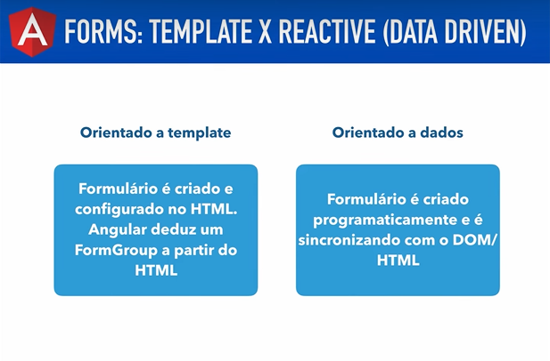

# Angular V2

## Aula 88 - Formulários Reativos (data driven) Introdução

No ecossistema do Angular Versão 2 (legado), os Formulários Reativos (também conhecidos como Data-Driven Forms ou Model-Driven Forms prescritos pelo módulo `ReactiveFormsModule`) representam a abordagem mais robusta, escalável e programática para construir formulários.

Diferente dos formulários orientados a template (Template-Driven), onde a estrutura lógica e o estado residem predominantemente no arquivo HTML, os formulários reativos estabelecem uma inversão de controle: toda a árvore de controle do formulário é explicitamente modelada e gerenciada no código TypeScript, enquanto o template atua apenas como uma camada de ligação passiva (binding).

### 1. A Filosofia e os Pilares dos Formulários Reativos

A arquitetura reativa do Angular baseia-se nos princípios da programação reativa (utilizando Observables do RxJS por baixo dos panos) e na mutabilidade síncrona/imutável dos dados. Os pilares fundamentais dessa abordagem são:

- **Modelo Explícito no TypeScript**: O desenvolvedor constrói a árvore de controles diretamente na classe do componente utilizando classes fundamentais (`FormControl`, `FormGroup` e `FormArray`). Isso significa que a regra de negócio do formulário existe e pode ser testada unitariamente mesmo antes de qualquer elemento HTML ser renderizado.
- **Fluxo de Dados Síncrono e Previsível**: Cada alteração em um campo emite um fluxo de dados controlado. Como o estado do formulário é uma estrutura síncrona baseada em objetos imutáveis, depurar e rastrear modificações torna-se extremamente previsível.
- **Separacao de Conceitos (SoC)**: O HTML perde a complexidade de gerenciar diretivas de validação longas ou estados profundos, focando exclusivamente em se ligar aos controles previamente declarados na classe por meio de diretivas de diretiva de vínculo (como `formControlName` e `formGroup`).

### 2. As Três Classes Fundamentais do Modelo

Para compreender o ecossistema reativo, é preciso entender os três blocos de construção que formam qualquer formulário no TypeScript:

- `FormControl`: É a menor unidade de controle reativo. Ele gerencia o valor individual, o estado de validação (válido/inválido), além de rastrear interações específicas como toque (`touched`/`untouched`) e modificação (`dirty`/`pristine`). Cada campo de input individual (como um campo de nome ou e-mail) corresponde a uma instância de `FormControl`.
- `FormGroup`: É o aglutinador de múltiplos `FormControl` ou de outros `FormGroup` aninhados. Ele representa uma seção ou o formulário inteiro, consolidando o estado global de validade e centralizando o objeto de valores consolidados de todos os seus filhos.
- `FormArray`: É a estrutura utilizada para gerenciar coleções dinâmicas de controles ou grupos cujos tamanhos podem variar em tempo de execução (como uma lista flexível de telefones, endereços adicionais ou itens de um carrinho de compras que podem ser adicionados ou removidos livremente pelo usuário).

### 3. Vantagens Estratégicas em Relação ao Template-Driven

- **Testabilidade Avançada**: Como a lógica de validação e a estrutura do formulário residem integralmente na classe TypeScript, você pode escrever testes unitários abrangentes cobrindo cenários de erro, valores iniciais e regras complexas sem precisar instanciar ou renderizar o DOM do navegador.
- **Validações Reativas e Assíncronas**: O modelo reativo facilita nativamente a aplicação de validadores dinâmicos, validações cruzadas entre múltiplos campos (como verificar se a senha e a confirmação coincidem em tempo real) e validadores assíncronos (como consultar uma API para verificar se um nome de usuário já está cadastrado) através de fluxos RxJS.
- **Reatividade em Tempo Real (`valueChanges` e `statusChanges`)**: Como cada controle expõe Observables integrados, você pode escutar alterações de valores ou status de validação de forma reativa, permitindo disparar comportamentos automáticos na interface (como exibir ou ocultar campos dinamicamente) assim que o usuário digita ou seleciona uma opção.

