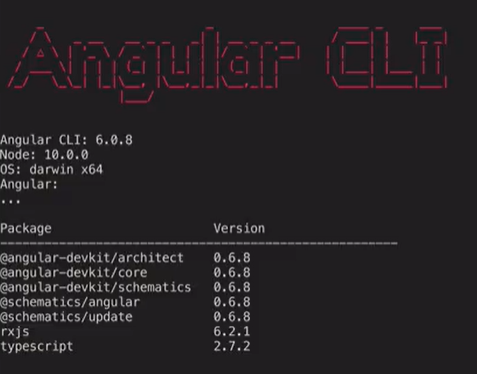
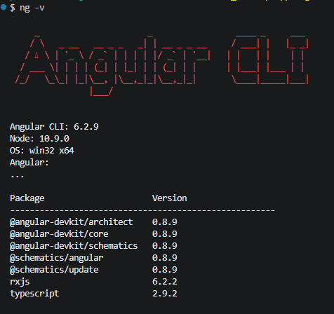

# Guiar de Atualização (Update Guide)

Para o Angular 6, você precisará abandonar o Node v6/v8 e migrar para versões intermediárias mais robustas:

Versão recomendada: Node.js v10.x (LTS - Dubnium) ou, no máximo. Utilizarei a versão 10.9.0 (npm 6.2.0).

Link para Download da Versão: https://nodejs.org/download/release/v10.9.0/

### Passo a Passo da Atualização

Comandos Executados Durante a Aula para a Atualização

```bash
# Atualização Angular CLI (atualizar no Package.json)
npm install --save-dev @angular/cli@lasted
npm install --save-dev @angular/cli@6.1.5

# Mostrar as Atualizações Disponíveis
ng update -d

ng update @angular/cli@6.1.10
ng update @angular/core@6.1.10
```



No Angular versão 6 (e em versões legadas da CLI baseadas no Webpack), não existe uma flag -d (dry-run) direta no comando ng update para simular o processo de atualização de pacotes dentro da mesma versão.

### Atualização Conforme o Guia angular.dev

Atualizando a Versão do Angular v5.2 para Versão 6.1, com complexidade básica utilizando o sistema operacional Windows com o npm como gerenciados de pacotes.

### URL de Acesso

[https://angular.dev/update-guide?v=5.2-6.1&l=1](https://angular.dev/update-guide)

### Guia para atualizar sua aplicação Angular da versão 5.2 para a versão 6.1 para aplicações básicas.

#### Antes de Atualizar

1. Substitua os componentes `downgradeComponent`, `downgradeInjectable`, `UpgradeComponent` e `UpgradeModule` importados de `@angular/upgrade`. Em vez disso, use as novas versões em `@angular/upgrade/static`.
2. Se você utiliza o `HttpModule` legado e o serviço `Http`, migre para o `HttpClientModule` e o serviço `HttpClient`. O `HttpClient` simplifica a ergonomia padrão (você não precisa mais mapear para JSON) e agora oferece suporte a valores de retorno tipados e interceptadores.

### Atualize para a nova versão

Analise essas alterações e execute as ações necessárias para atualizar sua inscrição.

- Certifique-se de estar usando o Node 8 ou posterior.
- Atualize seu Angular CLI e migre a configuração para o novo formato angular.json executando o seguinte comando:
```bash
cmd /C "set "NG_DISABLE_VERSION_CHECK=1" && npx @angular/cli@6 update @angular/cli@6 @angular/core@6"
```
- Atualize todos os pacotes do framework Angular para a versão 6 e utilize a versão correta do RxJS e do TypeScript.
```bash
cmd /C "set "NG_DISABLE_VERSION_CHECK=1" && npx @angular/cli@6 update @angular/cli@6 @angular/core@6"
```

Após a atualização, o TypeScript e o RxJS irão distribuir os tipos de forma mais precisa em sua aplicação, o que pode expor erros existentes nas tipagens da sua aplicação.

### Após a atualização

Remova recursos obsoletos do RxJS 5 usando regras de atualização automática do rxjs-tslint.

Para a maioria das aplicações, isso significará executar os dois comandos a seguir:

```bash
npx rxjs-tslint rxjs-5-to-6-migrate -p src/tsconfig.app.json
```

    **Nota**: Comandos não funcionaram...

### Exceção e Solução Aplicada

Infelizmente no momento as opções de upgrade utilizadas não se aplicam tendo em vista que a ultima versão atual encontra-se no Angular v22.

Devido a limitação do processo de upgrade de versões legadas na atualidade, foi necessário remover o `angular-cli.json` manualmente e criar o arquivo `angular.json`.
Constatado também que a necessidade de criar o arquivo `tsconfig.app.json`, arquivos e configurações disponiveis nos **assets**.

### Comandos de Atualização (Tentativa e Erro)

```bash
# Atualização Angular CLI (atualizar no Package.json)
npm install --save-dev @angular/cli@6.1.5

# Atualizar Versão dos package.json
npm install @angular/animations@^6.1.10 @angular/common@^6.1.10 @angular/compiler@^6.1.10 @angular/compiler-cli@^6.1.10 @angular/core@^6.1.10 @angular/forms@^6.1.10 @angular/http@^6.1.10 @angular/platform-browser@^6.1.10 @angular/platform-browser-dynamic@^6.1.10 @angular/platform-server@^6.1.10 @angular/router@^6.1.10 typescript@">=2.7.2 <2.8.10"

npm install -g @angular/cli@6.2.9
npm install --save-dev @angular/cli@6.2.9

npm install @angular-devkit/build-angular@~0.6.8 --save-dev

npm install typescript@~2.9.2 --save-dev

# Baixar as dependências do módulo node_modules
npm install
```

### Problemas identificados:

1. `rxjs` está na versão `^5.5.12` — precisa ser atualizado para `^6.x`
2. `rxjs-compat` está com versão errada (`^6.0.0-rc.0`), precisa ser `^6.1.0`
3. `import 'rxjs/add/operator/map'` no `template-form.component.ts` é sintaxe RxJS 5, incompatível com v6
4. `.map(res => res)` encadeado no `HttpClient`, no RxJS 6 precisa usar `pipe(map(...))`
5. `import { Http, Response } from '@angular/http'` no `dropdown.service.ts`, módulo deprecated

Versões Utilizadas

